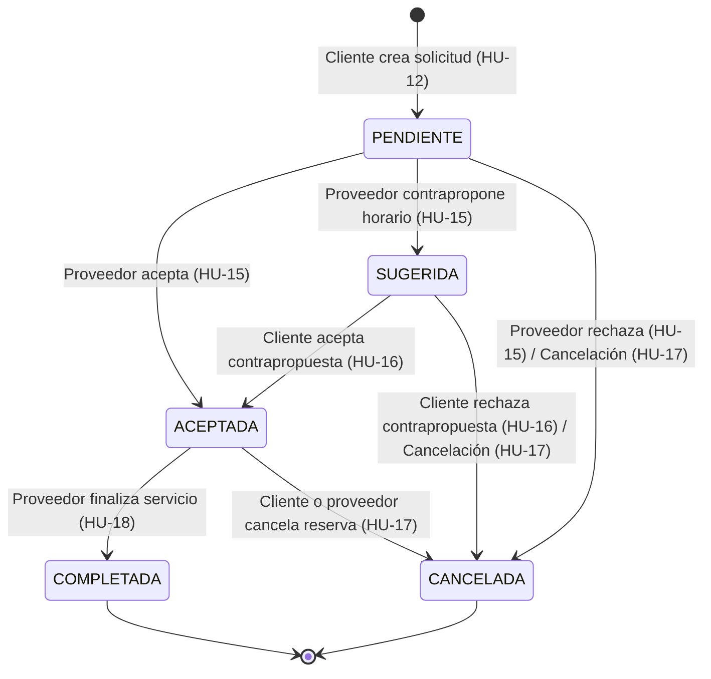

# Documentación Completa: BienestarEnCasa — Sprint 3 y Correcciones Integrales

**Proyecto:** Sistema Web de Servicios de Estética y Bienestar a Domicilio (*BienestarEnCasa*)  
**Repositorio base del equipo:** `https://github.com/santiagorivas-svg/BienestarEnCasa.git` (rama `main`)  
**Alcance principal del Sprint 3 (Responsable: Thomas Andrés):** HU-15, HU-16, HU-17 y HU-18  
**Estado de verificación:** 86/86 pruebas automatizadas pasando (`OK`), 0 errores en `manage.py check`, 0 migraciones pendientes, 0 errores de sintaxis JS.

---

## 1. Resumen Ejecutivo y Arquitectura General

**BienestarEnCasa** es una aplicación web construida con **Django 5.2**, **Django REST Framework (DRF)**, **SimpleJWT** y plantillas HTML + JavaScript vanilla (sin frameworks pesados de frontend), respaldada por **MySQL** (en producción/presentación) con soporte opcional de **SQLite** para desarrollo local rápido.

### Estructura del proyecto

```text
BienestarEnCasa-main/
├── README.md                 # Portada de GitHub, guía de instalación y ejecución de pruebas
├── .gitignore                # Reglas de exclusión para env/, .env, *.sqlite3, media/, .vscode/
├── docs/                     # Documentación técnica del proyecto y reporte de URLs
├── Backend/
│   ├── BienestarEnCasa/      # Configuración global: settings.py, urls.py, paginas_urls.py, __init__.py
│   ├── usuarios/             # Auth JWT, perfiles, direcciones, zonas, disponibilidad + carpeta tests/
│   ├── catalogo/             # Categorías, servicios, multimedia, elementos + carpeta tests/
│   ├── solicitudes/          # Solicitudes, límites, negociación, cancelación, cierre + carpeta tests/
│   ├── manage.py
│   ├── requirements.txt
│   └── .env.example
└── frontend/
    ├── static/               # estilos.css y logo.png
    └── templates/            # Plantillas HTML separadas por módulo (base, inicio, users, catalogo, solicitudes)
```

### Separación entre Páginas HTML y API REST

En `Backend/BienestarEnCasa/urls.py`, las rutas se resuelven en este orden:

1. `/admin/` → Panel de administración de Django.
2. `/api/auth/` → Registro, inicio de sesión, renovación de token, cierre de sesión y perfil actual (`usuarios.urls.urls`).
3. `/api/usuarios/` → Perfil del usuario y CRUD de direcciones del cliente (`usuarios.urls.api_urls`).
4. `/api/proveedores/` → Perfil profesional, zonas de atención, disponibilidad, periodos no disponibles y consulta pública de proveedores (`usuarios.urls.proveedores_urls`).
5. `/api/catalogo/` → Categorías, servicios, `servicios/mios/`, multimedia y elementos del servicio (`catalogo.urls`).
6. `/api/solicitudes/` → CRUD de solicitudes y acciones de negocio del Sprint 3 (`solicitudes.urls`).
7. `/recuperar-password/` y `/restablecer/<uidb64>/<token>/` → Flujo nativo de recuperación de contraseña por correo SMTP.
8. `''` (al final) → `BienestarEnCasa.paginas_urls`, que entrega las páginas HTML (la "cáscara" visual), las cuales cargan y modifican los datos consumiendo `/api/...` mediante `window.BEC.api` (excepto `/disponibilidad/`, que usa formularios tradicionales de Django en servidor).

---

## 2. Base de Datos: SQLite Local vs. MySQL de Presentación

No es necesario modificar código fuente para pasar de SQLite a su base de datos MySQL el día de la presentación.

### Cómo decide Django qué motor usar (`Backend/BienestarEnCasa/settings.py`)

- El archivo `Backend/BienestarEnCasa/__init__.py` ejecuta `pymysql.install_as_MySQLdb()`, habilitando el driver **PyMySQL** como conector nativo de MySQL para Django.
- En `settings.py`, `load_dotenv(BASE_DIR / '.env')` carga las variables de entorno:
  - Si existe `Backend/.env` con `DB_NAME` definido (y sin `USE_SQLITE=true`), Django conecta automáticamente a **MySQL** (`django.db.backends.mysql`, `charset: utf8mb4`).
  - Si **no** existe `Backend/.env` o se configura `USE_SQLITE=true`, utiliza `Backend/db.sqlite3`.

### Archivo `Backend/.env` requerido para presentar con MySQL

```env
DB_NAME=bienestarencasa
DB_USER=tu_usuario_mysql
DB_PASSWORD=tu_contrasena_mysql
DB_HOST=127.0.0.1
DB_PORT=3306
```

### Qué ocurre al ejecutar `migrate` sobre su MySQL existente

Al ejecutar `python Backend/manage.py migrate` apuntando a la base de datos MySQL del equipo:

1. **No se pierden datos previos:** Django consulta su tabla `django_migrations` y conserva todas las tablas y registros que ya existían de Sprints 1 y 2.
2. **Solo se aplican 2 migraciones nuevas:**
   - `solicitudes.0005_sprint3_negociacion_cierre`: añade a la tabla `solicitudes_solicitudreserva` las 7 columnas nuevas del Sprint 3 (`fecha_sugerida`, `hora_sugerida`, `comentario_contrapropuesta`, `cancelado_por`, `cancelado_en`, `completado_en`, `observaciones_finalizacion`). Las solicitudes previas quedan intactas con valores vacíos/`NULL` en esos campos.
   - `catalogo.0005_seed_categorias_iniciales`: inserta las 6 categorías base mediante `get_or_create`. Si en MySQL ya existen categorías con esos nombres, **no las duplica ni altera sus IDs**; si faltan, las crea automáticamente.
3. **Ventaja de concurrencia en MySQL (InnoDB):** las operaciones críticas (`aceptar`, `aceptar-contrapropuesta` y creación de solicitud) usan `transaction.atomic()` con `select_for_update()`. En MySQL InnoDB esto aplica **bloqueos reales por fila**, impidiendo reservas dobles si llegan dos peticiones simultáneas.

### Pasos exactos para levantar el proyecto el día de la presentación

```powershell
# 1. Confirmar que Backend\.env apunta a MySQL (y sin USE_SQLITE=true)
# 2. Aplicar migraciones nuevas sobre MySQL
.\env\Scripts\python.exe Backend\manage.py migrate

# 3. Verificar integridad del sistema
.\env\Scripts\python.exe Backend\manage.py check

# 4. Iniciar servidor
.\env\Scripts\python.exe Backend\manage.py runserver
```

---

## 3. Autenticación, Seguridad y Runtime del Frontend

### Autenticación en Backend (`usuarios/authentication.py` y `usuarios/views.py`)

- **Cookies `HttpOnly`:** al iniciar sesión (`POST /api/auth/iniciar-sesion/`), SimpleJWT genera `access` (8 horas) y `refresh` (7 días) y los guarda en cookies `HttpOnly` (`SameSite=Lax`). El JavaScript no puede leerlos, reduciendo el riesgo de XSS.
- **Protección CSRF:** `CookieJWTAuthentication` invoca `SessionAuthentication().enforce_csrf(request)`, obligando a que toda escritura (`POST`, `PATCH`, `PUT`, `DELETE`) incluya el encabezado `X-CSRFToken`.
- **Sesión única por usuario (`SesionActiva`):** cada login genera un `sid` único, guarda el registro en `SesionActiva` e invalida los tokens anteriores en `token_blacklist`. Si el usuario inicia sesión en otro dispositivo, la sesión anterior deja de ser válida.
- **Cierre de sesión real (`POST /api/auth/cerrar-sesion/`):** elimina `SesionActiva`, agrega el `refresh` token a la lista negra y borra las cookies `access` y `refresh`.

### Cliente Global Frontend (`frontend/templates/includes/runtime-bec.html`)

Todas las vistas heredan de `base.html`, que carga `window.BEC`:

- `BEC.cfg`: catálogo centralizado de rutas API y páginas HTML.
- `BEC.api(url, options)`:
  - Envía `credentials: 'include'` y `X-CSRFToken` automáticamente.
  - Serializa objetos a JSON (o respeta `FormData` para subida de fotos/videos).
  - Si recibe `401 Unauthorized` por token vencido, llama automáticamente a `/api/auth/renovar-token/` y reintenta la petición una vez antes de redirigir al inicio (desactivable con `redirectOn401: false` en login/registro).
- `BEC.requiereSesion(rolesPermitidos)`: consulta `/api/auth/mi-perfil/` y valida que el usuario esté autenticado y tenga un rol autorizado.
- `BEC.cerrarSesion()`: llama a `POST /api/auth/cerrar-sesion/`, limpia `localStorage` y redirige a `/`.
- `BEC.escaparHtml()`, `BEC.extraerError()`, `BEC.mensaje()`, `BEC.mensajeError()`, `BEC.ocupado()`: utilidades seguras contra XSS y formateo legible de errores de DRF.

---

## 4. Implementación Completa del Sprint 3 (HU-15, HU-16, HU-17 y HU-18)

### Máquina de Estados de `SolicitudReserva`



> **Inmutabilidad:** una vez en `COMPLETADA` o `CANCELADA`, la solicitud no puede modificarse ni por acciones ni por `PATCH`.

### Campos agregados al modelo (`Backend/solicitudes/models.py`)

| Campo | Tipo | Propósito |
|---|---|---|
| `fecha_sugerida` | `DateField(null=True, blank=True)` | Fecha propuesta por el proveedor en una contrapropuesta (HU-15/HU-16). |
| `hora_sugerida` | `TimeField(null=True, blank=True)` | Hora propuesta por el proveedor, sin sobrescribir la original hasta que el cliente acepte. |
| `comentario_contrapropuesta` | `TextField(blank=True, default='')` | Mensaje opcional explicando el cambio de horario. |
| `cancelado_por` | `CharField(choices=CLIENTE/PROVEEDOR)` | Trazabilidad de quién canceló o rechazó la solicitud (HU-15/HU-16/HU-17). |
| `cancelado_en` | `DateTimeField(null=True, blank=True)` | Marca de tiempo exacta de la cancelación/rechazo. |
| `completado_en` | `DateTimeField(null=True, blank=True)` | Marca de tiempo exacta de finalización del servicio (HU-18). |
| `observaciones_finalizacion` | `TextField(blank=True, default='')` | Comentario opcional de cierre registrado por el proveedor (HU-18). |

Además, `SolicitudReserva` conserva las copias congeladas (`nombre_servicio_copia`, `precio_copia`, `duracion_minutos_copia`), de modo que editar o desactivar el servicio después nunca altera las solicitudes existentes.

### Endpoints de Sprint 3 (`Backend/solicitudes/views.py`)

| HU | Método y Ruta | Actor autorizado | Estado requerido | Validaciones clave y efecto |
|---|---|---|---|---|
| **HU-15** | `POST /api/solicitudes/{id}/aceptar/` | Proveedor asignado | `PENDIENTE` | Lock atómico (`select_for_update`), valida disponibilidad/bloqueos (`validar_horario_reserva`) y ausencia de traslape con otras `ACEPTADA` (`validar_conflicto_proveedor`). Pasa a `ACEPTADA`. |
| **HU-15** | `POST /api/solicitudes/{id}/rechazar/` | Proveedor asignado | `PENDIENTE` | Exige `motivo` obligatorio (no vacío). Pasa a `CANCELADA`, `cancelado_por='PROVEEDOR'`, guarda `cancelado_en` y motivo. |
| **HU-15** | `POST /api/solicitudes/{id}/contraproponer/` | Proveedor asignado | `PENDIENTE` | Exige `hora_sugerida` (y `fecha_sugerida` opcional; por defecto la original), distinta a la original. Valida disponibilidad y no conflicto del proveedor. Conserva fecha/hora originales y pasa a `SUGERIDA`. |
| **HU-16** | `POST /api/solicitudes/{id}/aceptar-contrapropuesta/` | Cliente propietario | `SUGERIDA` | Lock atómico sobre proveedor, cliente y solicitud. Re-valida disponibilidad del proveedor, no conflicto del proveedor y límites del cliente (no traslape + máx. 3 activas/día). Copia `fecha_sugerida`/`hora_sugerida` a `fecha_solicitada`/`hora_solicitada` y pasa a `ACEPTADA`. |
| **HU-16** | `POST /api/solicitudes/{id}/rechazar-contrapropuesta/` | Cliente propietario | `SUGERIDA` | Motivo opcional (respaldo: `"Contrapropuesta rechazada por el cliente."`). Pasa a `CANCELADA` con `cancelado_por='CLIENTE'` y `cancelado_en`. |
| **HU-17** | `POST /api/solicitudes/{id}/cancelar/` | Cliente propietario o Proveedor asignado | `PENDIENTE`, `SUGERIDA` o `ACEPTADA` | Exige `motivo` obligatorio. Bloquea si ya está `CANCELADA` o `COMPLETADA`. Registra `cancelado_por` y `cancelado_en`. **Libera automáticamente el horario** para ambas partes. |
| **HU-18** | `POST /api/solicitudes/{id}/finalizar/` | Proveedor asignado | `ACEPTADA` | `observaciones_finalizacion` opcionales. Registra `completado_en`, pasa a `COMPLETADA` y vuelve la reserva inmutable. |

Adicionalmente:
- `GET /api/solicitudes/?estado=<ESTADO>` permite filtrar solicitudes por estado desde el backend.
- `PATCH /api/solicitudes/{id}/` refuerza las transiciones válidas de estado, los roles autorizados y el chequeo de conflictos para evitar que se salten reglas de negocio fuera de las acciones.
- Usuarios ajenos reciben `404` (filtrado a nivel de `get_queryset()`), roles no autorizados reciben `403` y anónimos reciben `401`.

### Reglas de agenda y límites (`Backend/solicitudes/limites.py`)

- **Estados activos:** `PENDIENTE`, `SUGERIDA` y `ACEPTADA` (las `CANCELADA` y `COMPLETADA` no ocupan cupo ni horario).
- **Límites del cliente (`validar_limites_cliente`):**
  1. No puede tener dos solicitudes activas que se traslapen en tiempo el mismo día (`inicio < existente_fin and fin > existente_inicio`). Dos citas consecutivas exactas (ej. 10:00–11:00 y 11:00–12:00) sí se permiten.
  2. Máximo **3 solicitudes activas por día** por cliente.
  3. Acepta `excluir_solicitud_id` para no colisionar consigo misma al aceptar una contrapropuesta.
- **Conflicto del proveedor (`validar_conflicto_proveedor`):**
  - Impide que un proveedor tenga dos reservas `ACEPTADA` superpuestas en fecha y horario.

### Pantallas del Sprint 3

- **Panel del Proveedor (`frontend/templates/users/plantilla-proveedor.html`):**
  - Sección *Por responder* (`PENDIENTE`) con botones *Aceptar*, *Contraproponer horario*, *Rechazar* y *Ver detalle*.
  - Sección *Gestionadas / Agenda* con filtro por estado (`SUGERIDA`, `ACEPTADA`, `COMPLETADA`, `CANCELADA`), badges diferenciados, bloque de contrapropuesta/motivo/cierre y acciones *Finalizar servicio* y *Cancelar*.
  - Pestaña *Mis clientes* (reservas `ACEPTADA` y `COMPLETADA` en orden cronológico) también con acciones *Finalizar* y *Cancelar*.
  - Modales dedicados: `#modalContraproponer` (fecha + franjas reales según disponibilidad y duración + comentario), `#modalMotivoProveedor` (rechazo y cancelación) y `#modalFinalizarServicio`.
- **Mis Solicitudes (`frontend/templates/solicitudes/mis-solicitudes.html`):**
  - Buscador por texto + filtros por estado y categoría.
  - Cuando una solicitud está `SUGERIDA`, muestra el recuadro de contrapropuesta del proveedor con botones *Aceptar contrapropuesta* y *Rechazar contrapropuesta*.
  - Muestra botón *Cancelar* en estados activos con modal de motivo obligatorio (`#modalAccionCliente`), así como bloques de cierre o motivo de cancelación.
- **Detalle de Solicitud (`frontend/templates/solicitudes/detalle-solicitud.html`):**
  - Adaptado a `CLIENTE` y `PROVEEDOR`: muestra información del servicio, reserva, dirección, bloque de contrapropuesta, bloque de finalización, bloque de cancelación y controles de acción acordes al rol y estado.

---

## 5. Diagnóstico y Correcciones Realizadas al Proyecto

### A. Por qué fallaba "Agregar un servicio" y cómo se resolvió

1. **Tabla `catalogo_categoria` vacía en local:** en el repo del equipo no existía migración de datos ni seed de categorías porque ellos las creaban a mano en MySQL. Al levantar en SQLite, `GET /api/catalogo/categorias/` devolvía `[]`.
2. **Opciones falsas en `mis-servicios.html`:** cuando llegaban 0 categorías, el modal rellenaba manualmente `<option value="1">Peluquería</option>` y `<option value="2">Masajes no Médicos</option>`. Al guardar, DRF rechazaba `categoria: 1` con `400 Bad Request` (*objeto no existe*). En `/mis-servicios/nuevo/`, el formulario quedaba oculto.
3. **Visualización rota de categoría en tarjetas:** `mis-servicios.html` leía `s.categoria.nombre` en lugar de `s.categoria_detalle.nombre`, mostrando siempre `VARIOS`.

**Solución:** se creó la migración de datos idempotente `0005_seed_categorias_iniciales.py`, se eliminaron las opciones falsas en `mis-servicios.html`, se corrigió la lectura de `s.categoria_detalle.nombre`, se añadió validación de precio/duración en español, protección por rol `PROVEEDOR` y recarga limpia al eliminar el último servicio.

### B. Correcciones de Autenticación, Registro y Navegación

- **Registro sin sesión (`registro.html` y `runtime-bec.html`):** en el repo de tus compañeros el registro redirigía a `` (ruta de API `/api/auth/mi-perfil/` en vez de la página `/mi-perfil/`) y sin iniciar sesión, causando `401` inmediato. Se corrigió para iniciar sesión automáticamente (estableciendo cookies JWT) y redirigir a `pagina-panel-proveedor` o `pagina-perfil`.
- **Cierre de sesión incompleto (`runtime-bec.html`):** `BEC.cerrarSesion()` ahora hace `POST /api/auth/cerrar-sesion/` antes de borrar `localStorage` y redirigir, invalidando cookies y sesión en servidor.
- **Funciones faltantes en `window.BEC`:** se implementaron `BEC.mensaje`, `BEC.mensajeError`, `BEC.ocupado`, `BEC.escaparHtml` y `BEC.extraerError`, usadas por `iniciar-sesion.html`, `perfil-proveedor.html` y `detalle-servicio.html`.
- **Login `/iniciar-sesion/` y modal (`iniciar-sesion.html`, `base.html`):** se agregó `redirectOn401: false` y `` para mostrar error ante credenciales incorrectas en vez de redirigir a `/`; el modal ahora responde a la tecla **Enter**; se movió el script del menú hamburguesa fuera de `base.html` hacia `runtime-bec.html` (corrigiendo `test_base_template_no_incrusta_codigo_javascript`).
- **Landing page (`inicio.html`):** los botones *Ver detalles* y *Explora servicios* ahora redirigen a `/catalogo/` o `/panel-proveedor/` si el usuario ya inició sesión.
- **Recuperación de contraseña (`usuarios/forms.py` y `usuarios/tests.py`):** se eliminó el lookup DNS bloqueante `socket.gethostbyname` y la enumeración de correos en `CustomPasswordResetForm`, y se ajustó `follow=True` en la prueba del enlace `PasswordResetConfirmView` (que redirige 302 → `set-password` → 200). Con esto pasaron las 3 pruebas de recuperación que fallaban.

### C. Correcciones en Perfiles, Disponibilidad, Direcciones y Zonas

- **Biografía del proveedor (`mi-perfil.html`):** se corrigió la condición de carrera al consultar el rol y ahora usa `POST` si el proveedor aún no tiene `PerfilProveedor` (evitando el `404` silencioso al hacer `PATCH` por primera vez).
- **Disponibilidad (`/disponibilidad/`):** `GestionarDisponibilidadPageView` y `disponibilidad-proveedor.html` ahora marcan `selected` las horas guardadas al recargar la página (antes los `<select>` volvían vacíos y fallaban al volver a guardar).
- **`Direccion.__str__` (`usuarios/models.py`):** corregido `self.barrio_sector` (inexistente tras migración 0006) → `self.barrio`.
- **Django Admin (`catalogo/admin.py`, `usuarios/admin.py`, `solicitudes/admin.py`):** registrados todos los modelos del sistema para consulta y administración.
- **Zonas y direcciones (`zonas-atencion.html`, `direcciones.html`):** migración de borrado a `BEC.api` (quitando ruta inexistente `/api/zonas-cobertura/`), escape HTML seguro y control de rol.

### D. Correcciones en Catálogo y Solicitudes

- **Catálogo (`list-servicios.html`, `detalle-servicio.html`):** llamadas migradas de `fetch` crudo a `BEC.api` (renovación automática JWT), eliminados textos literales como `{Descripción del servicio}` y agregado enlace del servicio al perfil público del proveedor.
- **Crear solicitud (`solicitudes-crear.html`, `solicitudes/serializers.py`):** migrado a `BEC.api`, precarga de dirección principal + selector rápido de direcciones guardadas del cliente, filtrado de franjas según duración del servicio, conservación de datos personales tras enviar, validación obligatoria de `servicio` en backend (`400` en vez de `500`), `proveedor` derivado automáticamente del servicio si se omite, y exposición de `categoria_nombre` en `SolicitudReservaSerializer`.
- **Panel proveedor (`plantilla-proveedor.html`):** validación de rol `PROVEEDOR`, formateo correcto de horas con minutos, eliminación del teléfono ficticio `+57 300 000 0000`, uso de `BEC.api` para leer disponibilidad, corrección del modal de contrapropuesta para días no laborables/horas pasadas/duración y enlaces *Ver detalle* en todas las tarjetas.

---

## 6. Inventario Completo de Archivos Nuevos y Modificados

Comparado directamente contra `santiagorivas-svg/BienestarEnCasa` (`main`):

### Archivos nuevos y reorganizados
| Archivo / Carpeta | Descripción |
|---|---|
| `README.md` | Portada profesional para GitHub con estructura, instalación MySQL/SQLite, Sprint 3 y pruebas. |
| `docs/` | Carpeta de documentación (`DOCUMENTACION_SPRINT3_Y_CORRECCIONES.md` y `reporte_paginas_urls.txt`). |
| `Backend/catalogo/migrations/0005_seed_categorias_iniciales.py` | Migración de datos idempotente que crea las 6 categorías iniciales. |
| `Backend/solicitudes/migrations/0005_sprint3_negociacion_cierre.py` | Migración de esquema con los 7 campos del Sprint 3 en `SolicitudReserva`. |
| `Backend/usuarios/tests/` | Suite modularizada en `test_autenticacion.py`, `test_perfil_cliente.py` y `test_perfil_proveedor.py`. |
| `Backend/catalogo/tests/` | Suite modularizada en `test_catalogo_api.py` y `test_paginas_y_regresion.py`. |
| `Backend/solicitudes/tests/` | Suite modularizada en `test_creacion_y_limites.py` y `test_sprint3_negociacion_cierre.py`. |

*(Se eliminaron los monolitos `tests.py` reemplazados por los paquetes `tests/` y el archivo temporal `preview.png`.)*

### Archivos modificados en Backend
| Archivo | Cambios principales |
|---|---|
| `Backend/.env.example` | Plantilla documentada para MySQL y opción `USE_SQLITE`. |
| `Backend/BienestarEnCasa/settings.py` | Selección automática de MySQL (con `.env`) o SQLite local sin `.env`. |
| `Backend/catalogo/admin.py` | Registro de `Categoria`, `Servicio`, `ContenidoMultimediaServicio` y `ElementoServicio`. |
| `Backend/solicitudes/admin.py` | Registro de `SolicitudReserva` con filtros y búsqueda. |
| `Backend/solicitudes/limites.py` | Parámetro `excluir_solicitud_id` en `validar_limites_cliente` y nueva función `validar_conflicto_proveedor`. |
| `Backend/solicitudes/models.py` | Enum `CanceladoPor`, campos de contrapropuesta, cancelación y finalización (Sprint 3) y limpieza de imports. |
| `Backend/solicitudes/serializers.py` | `cliente_telefono`, `categoria_nombre`, validación de máquina de estados e inmutabilidad, validación de `servicio` requerido y 5 serializers de acciones Sprint 3. |
| `Backend/solicitudes/views.py` | Helpers de permisos, filtro `?estado=`, hardening de `perform_update`, 7 acciones REST de HU-15 a HU-18 con bloqueos atómicos y limpieza de imports. |
| `Backend/usuarios/admin.py` | Registro de `PerfilProveedor`, `Direccion` y `ZonaAtencion`. |
| `Backend/usuarios/forms.py` | `CustomPasswordResetForm` limpio sin enumeración de usuarios ni lookups DNS bloqueantes. |
| `Backend/usuarios/models.py` | Corrección de `Direccion.__str__` (`self.barrio`). |
| `Backend/usuarios/views.py` | Exposición de `opciones_hora`, `hora_inicio_valor` y `hora_fin_valor` en `GestionarDisponibilidadPageView` y eliminación de código muerto. |

### Archivos modificados en Frontend (17)
| Archivo | Cambios principales |
|---|---|
| `frontend/templates/base.html` | Submit por Enter en modal login, URLs con ``, retiro de `<script>` inline. |
| `frontend/templates/includes/runtime-bec.html` | Rutas API Sprint 3, `cerrarSesion` real en backend, `escaparHtml`, `extraerError`, `mensaje`, `mensajeError`, `ocupado`, auto-login tras registro y menú móvil. |
| `frontend/templates/inicio.html` | Botones CTA conscientes de sesión iniciada. |
| `frontend/templates/catalogo/mis-servicios.html` | Categorías reales sin fallback falso, categoría correcta en tarjeta, validaciones, rol `PROVEEDOR`, recarga al eliminar. |
| `frontend/templates/catalogo/list-servicios.html` | Migrado a `BEC.api` y escape HTML en filtros. |
| `frontend/templates/catalogo/detalle-servicio.html` | Eliminados placeholders literales, enlace al perfil del proveedor y comparación de estado normalizada. |
| `frontend/templates/solicitudes/solicitudes-crear.html` | Migrado a `BEC.api`, selector/precarga de direcciones guardadas, franjas según duración y mensajes de error legibles. |
| `frontend/templates/solicitudes/mis-solicitudes.html` | UI completa de HU-16 y HU-17 (aceptar/rechazar contrapropuesta, cancelar con motivo, filtro por estado) y control de rol `CLIENTE`. |
| `frontend/templates/solicitudes/detalle-solicitud.html` | Vista completa de contrapropuesta, cancelación, finalización y acciones Sprint 3 según rol. |
| `frontend/templates/users/plantilla-proveedor.html` | UI completa de HU-15, HU-17 y HU-18, modales, filtro de gestionadas, disponibilidad vía `BEC.api`, validación de rol y enlaces *Ver detalle*. |
| `frontend/templates/users/disponibilidad-proveedor.html` | Preservación de horas guardadas (`selected`) y errores inline por día. |
| `frontend/templates/users/mi-perfil.html` | Carga secuencial sin race condition y soporte `POST`/`PATCH` para biografía del proveedor. |
| `frontend/templates/users/iniciar-sesion.html` | `` y `redirectOn401: false` para mostrar errores de credenciales. |
| `frontend/templates/users/registro.html` | Auto-login JWT tras registro, redirección correcta y mensajes completos de validación. |
| `frontend/templates/users/direcciones.html` | Escape HTML seguro y mensajes de error formateados. |
| `frontend/templates/users/zonas-atencion.html` | Eliminación vía `BEC.api`, escape HTML y control de rol `PROVEEDOR`. |
| `frontend/templates/users/perfil-proveedor.html` | `` y compatibilidad con helpers de `window.BEC`. |

---

## 7. Cumplimiento del Sprint Planning (HU-01 a HU-19)

| Sprint | Historias de Usuario | Estado |
|---|---|---|
| **Sprint 1** | HU-01 Registro por rol, HU-02 Login/Logout JWT, HU-03 Recuperación de contraseña, HU-04 Perfil cliente y direcciones, HU-05 Perfil proveedor y zonas, HU-06 Registro de servicio, HU-07 Edición y estado de servicio, HU-08 Multimedia y elementos, HU-09 Exploración/búsqueda, HU-10 Perfil público y detalle | ✅ 10/10 Completas |
| **Sprint 2** | HU-11 Disponibilidad y periodos no disponibles, HU-12 Creación de solicitud con reglas, HU-13 Consulta cliente, HU-14 Consulta proveedor, HU-19 Agenda del proveedor | ✅ 5/5 Completas |
| **Sprint 3** | HU-15 Respuesta del proveedor (Aceptar / Rechazar / Contraproponer), HU-16 Respuesta del cliente a contrapropuesta, HU-17 Cancelación con motivo y liberación de agenda, HU-18 Finalización del servicio | ✅ 4/4 Completas |

---

## 8. Resultados de Pruebas y Verificación

| Verificación | Comando ejecutado | Resultado |
|---|---|---|
| Integridad de Django | `.\env\Scripts\python.exe Backend\manage.py check` | `System check identified no issues (0 silenced).` |
| Migraciones pendientes | `.\env\Scripts\python.exe Backend\manage.py makemigrations --check --dry-run` | `No changes detected` |
| Suite completa de pruebas | `.\env\Scripts\python.exe Backend\manage.py test usuarios catalogo solicitudes` | **86 tests ejecutados — `OK` (0 fallos, 0 errores)** |
| Sintaxis JS en plantillas | Validación con `node` en todo `frontend/templates/**/*.html` | **0 errores de sintaxis** |
| Renderizado de rutas HTML | Petición GET a las 19 rutas definidas en `paginas_urls.py` y recuperación | **18 rutas `200 OK` + `/disponibilidad/` anónimo `302`** |

---

## 9. Guion Sugerido para la Demostración en Vivo (Sprint 3)

Para lucir todo el flujo completo de tus 4 historias de usuario en 5 minutos (usando dos ventanas o una normal + una incógnito):

1. **Preparación (Proveedor):** iniciar sesión como proveedor → abrir **Mis Servicios** y crear o mostrar un servicio activo con categoría real → abrir **Disponibilidad** y mostrar un horario guardado (ej. Lunes a Viernes 8:00 AM–5:00 PM).
2. **Crear solicitud (Cliente, HU-12):** iniciar sesión como cliente en ventana incógnito → ir a **Catálogo** → seleccionar el servicio → solicitar una cita (ver dirección precargada y hora fin calculada). Queda en `PENDIENTE`.
3. **Contraproponer horario (Proveedor, HU-15):** en el **Panel de Proveedor**, sobre la solicitud `PENDIENTE`, clic en **Contraproponer horario** → elegir nueva fecha/hora disponible y escribir un comentario → enviar. Pasa a `SUGERIDA` conservando la original.
4. **Aceptar contrapropuesta (Cliente, HU-16):** en **Mis Solicitudes**, ver el recuadro naranja de contrapropuesta → clic en **Aceptar contrapropuesta**. La fecha/hora se actualiza automáticamente y pasa a `ACEPTADA`.
5. **Finalizar servicio (Proveedor, HU-18):** en el **Panel de Proveedor** (en *Gestionadas / Agenda* o *Mis clientes*), clic en **Finalizar servicio** → agregar observación de cierre → confirmar. Pasa a `COMPLETADA` y el cliente lo ve reflejado en su detalle.
6. **Rechazo y Cancelación con liberación de agenda (HU-15 y HU-17):**
   - Crear una segunda solicitud → el proveedor la **Rechaza** indicando motivo obligatorio (`CANCELADA` por proveedor).
   - Crear una tercera solicitud → el proveedor la **Acepta** → luego cliente o proveedor la **Cancela** con motivo obligatorio → demostrar que ese mismo horario vuelve a quedar libre para agendar nuevamente.
